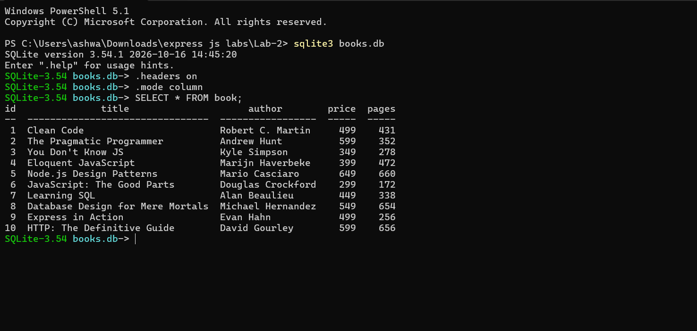
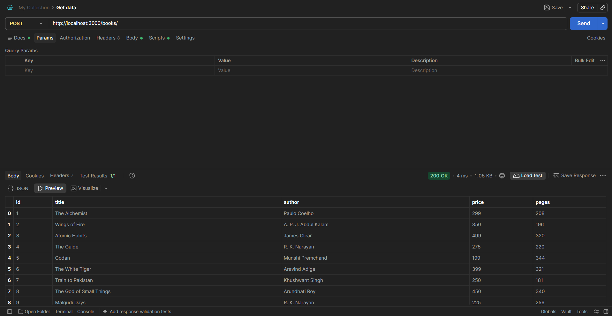
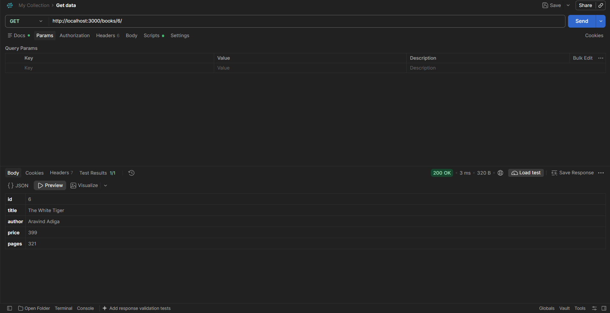
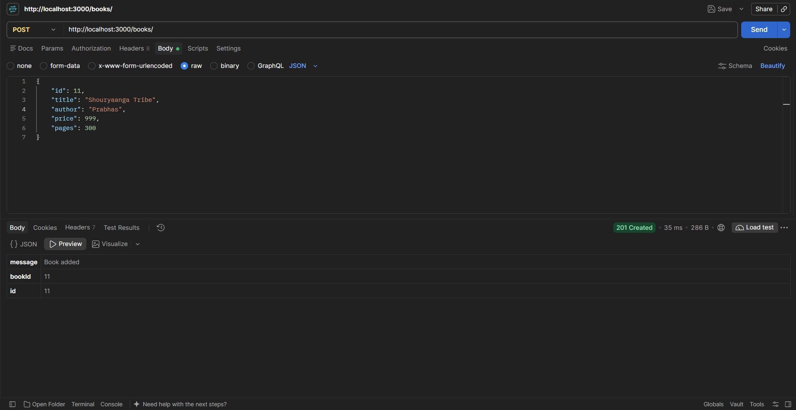
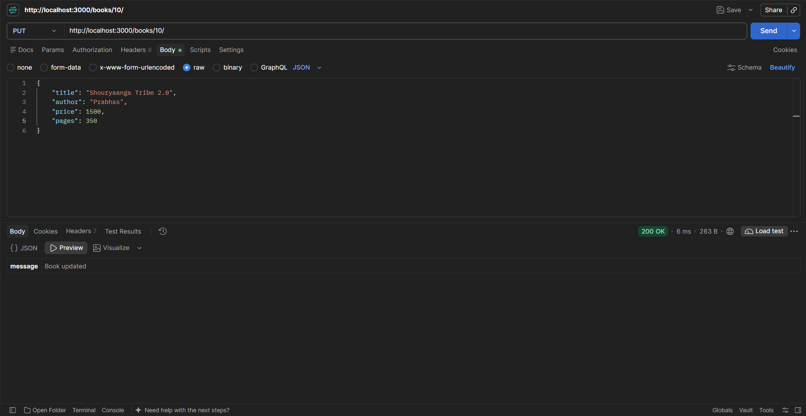
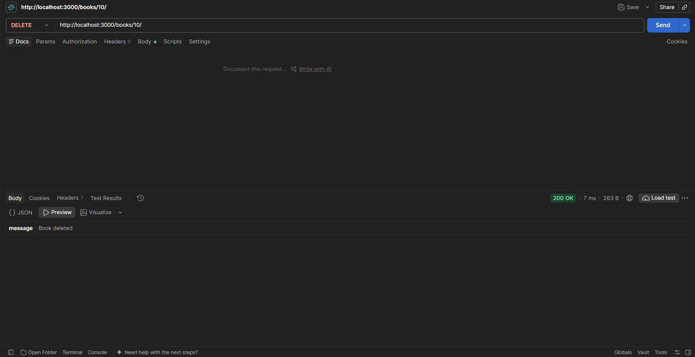
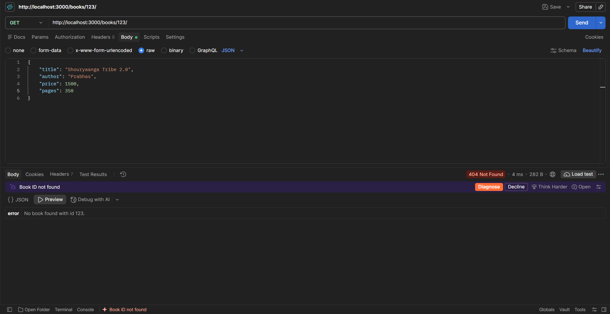
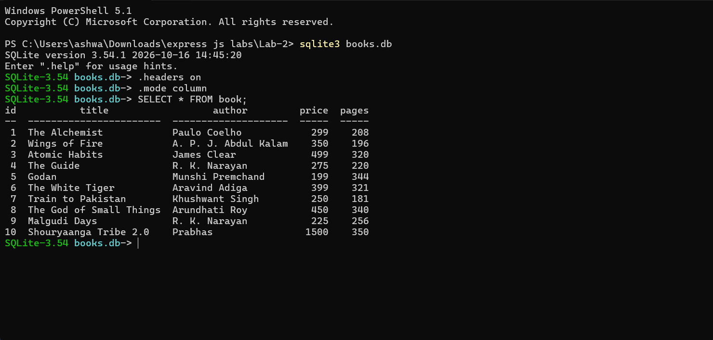

# Lab 2: SQLite database and CRUD routes

## Student Details

- **Name:** PAKALA ASHWANTH
- **Registration Number:** 252U1R7072
- **Section:** CSE FSD - [2B]
- **Course:** Backend Development Fundamentals
- **Lab Number:** 02

## Live Link

https://backend-development-lab-02.vercel.app/

## Objective

To connect an Express.js server to an SQLite database (`books.db`) and expose full CRUD (Create, Read, Update, Delete) routes over HTTP using parameterized SQL queries (`?` placeholders) to prevent SQL injection, comprehensive input validation, and standard HTTP status codes.

## Technologies Used

- Node.js
- Express.js
- SQLite3 (`sqlite` wrapper and `sqlite3` native driver)
- Nodemon (development dependency)
- JavaScript (ES6+ async/await)

## Project Structure

```text
Lab-2/
├── screenshots/
│   ├── cli-before.png
│   ├── get-all.png
│   ├── get-one.png
│   ├── post.png
│   ├── put.png
│   ├── delete.png
│   ├── not-found.png
│   └── cli-after.png
├── server.js
├── seed.sql
├── books.db
├── package.json
├── package-lock.json
├── .gitignore
└── README.md
```

## package.json Fields Explained

| Field | Description |
|---|---|
| `name` | The package identifier (`express-js-lab-2`) |
| `version` | The semantic version of the project (`1.0.0`) |
| `description` | Summary of the lab assignment |
| `main` | Entry point file of the application (`server.js`) |
| `scripts` | Command shortcuts: `start` runs `node server.js`; `dev` runs `nodemon server.js` |
| `dependencies` | Runtime dependencies: `express` (routing and HTTP), `sqlite` (promise wrapper), `sqlite3` (SQLite engine) |
| `devDependencies` | Development-only tools: `nodemon` (auto-restarts server on file change) |

## Installation and Setup

### Prerequisites

- Node.js (v18 or higher recommended) and npm installed
- Visual Studio Code or any modern code editor

### Steps to Run

1. Open the project folder in terminal:
   ```bash
   cd Lab-2
   ```

2. If PowerShell on Windows restricts script execution, set bypass for the current session:
   ```powershell
   Set-ExecutionPolicy -Scope Process -ExecutionPolicy Bypass
   ```

3. Install project dependencies:
   ```bash
   npm install
   ```

4. Start the Express server:
   ```bash
   npm start
   ```
   Or for auto-reloading during development:
   ```bash
   npm run dev
   ```

5. The server is ready at:
   `http://localhost:3000`

## Database

### Table Schema

The database file `books.db` contains a single table named `book` defined as follows:

```sql
CREATE TABLE book (
  id      INTEGER PRIMARY KEY,
  title   TEXT    NOT NULL,
  author  TEXT    NOT NULL,
  price   INTEGER NOT NULL,
  pages   INTEGER NOT NULL
);
```

### Rebuilding the Database from `seed.sql`

To reset or recreate `books.db` with the 10 initial sample records using the SQLite CLI:

```bash
sqlite3 books.db < seed.sql
```

### Inspecting the Database with SQLite CLI

To view table contents directly from the terminal:

```bash
sqlite3 books.db
```

Inside the SQLite prompt:
```sql
.headers on
.mode column
SELECT * FROM book;
.exit
```

## Endpoints

| Method | Endpoint | Description | Success Status |
|---|---|---|---|
| GET | `/books/` | Retrieves the list of all books | 200 OK |
| GET | `/books/:bookId/` | Retrieves a single book by its ID | 200 OK |
| POST | `/books/` | Adds a new book from the JSON request body | 201 Created |
| PUT | `/books/:bookId/` | Updates all fields of an existing book | 200 OK |
| DELETE | `/books/:bookId/` | Deletes a book by its ID | 200 OK |

*Note: All routes support requests both with and without a trailing slash (e.g., `/books` and `/books/`).*

### Request Body Format (POST and PUT)

```json
{
  "title": "Clean Code",
  "author": "Robert C. Martin",
  "price": 499,
  "pages": 431
}
```

### Error Responses

| Scenario | Status Code | Response Body |
|---|---|---|
| `bookId` is not a positive whole number (e.g., `abc`, `-1`, `0`, `1.5`) | 400 Bad Request | `{"error": "bookId must be a positive whole number."}` |
| Missing or invalid field in POST/PUT body | 400 Bad Request | `{"error": "Request body must include: title (string), author (string), price (integer), pages (integer)."}` |
| Malformed JSON syntax in request body | 400 Bad Request | `{"error": "Malformed JSON in request body."}` |
| Book ID does not exist in database (GET, PUT, DELETE) | 404 Not Found | `{"error": "No book found with id <bookId>."}` |
| Unknown / unhandled route | 404 Not Found | `{"error": "404 - Route not found."}` |
| Unexpected database or server error | 500 Internal Server Error | `{"error": "Internal server error. ..."}` |

## Screenshots

### 1. SQLite CLI — Initial Seed State

Displays the 10 initial sample books populated from `seed.sql`.



### 2. GET All Books

Retrieves all books stored in the database (`GET /books/`).



### 3. GET Single Book

Retrieves a single book by ID (`GET /books/1/`).



### 4. POST Create Book

Adds a new book record and returns 201 Created with the generated ID (`POST /books/`).



### 5. PUT Update Book

Updates all attributes of an existing book (`PUT /books/1/`).



### 6. DELETE Book

Deletes an existing book record (`DELETE /books/11/`).



### 7. 404 Not Found Route

Demonstrates proper handling of non-existent routes (`GET /unknown`).



### 8. SQLite CLI — Database State After Tests

Displays the database contents after running create, update, and delete tests.



## HTTP Status Codes

- **200 OK:** Standard success response for `GET`, `PUT`, and `DELETE` operations.
- **201 Created:** Returned when a new resource is successfully created via `POST`, accompanied by the new book ID.
- **400 Bad Request:** Returned when client input is invalid, such as a non-integer `bookId`, missing JSON body properties, or malformed JSON syntax.
- **404 Not Found:** Returned when the requested endpoint does not exist, or when no book matching the provided ID is found in the database.
- **500 Internal Server Error:** Returned as a fail-safe when an unexpected database exception or server error occurs.

## Viva Questions and Answers

### 1. What is SQL Injection, and how do parameterized queries (`?` placeholders) prevent it?

SQL injection is a severe security vulnerability where untrusted client input is directly concatenated into a SQL statement string, allowing malicious actors to alter query logic (for example, entering `' OR '1'='1` to bypass authentication or extract sensitive tables). 

Using `?` placeholders passes values separately as query parameters. The database driver treats parameter values strictly as literal data, never as executable SQL commands, completely neutralizing SQL injection risks.

### 2. What is the difference between POST and PUT in RESTful APIs?

- **POST (`/books/`):** Used to create a new resource. The server assigns the resource identifier (such as an auto-incremented primary key) and returns HTTP 201 Created. Multiple identical POST requests create multiple distinct resources (it is not idempotent).
- **PUT (`/books/:bookId/`):** Used to update or replace an existing resource at a known URI. Sending the same PUT request multiple times produces the same end state (it is idempotent).

### 3. Why is HTTP status code 201 Created used for POST instead of 200 OK?

HTTP 200 OK signifies general success, but HTTP 201 Created explicitly confirms that one or more new resources have been successfully provisioned on the server. In REST standards, 201 is the designated success status for resource creation and is typically accompanied by the identity or URI of the new entity.

### 4. What is a `PRIMARY KEY` in SQLite, and what happens when it is defined as `INTEGER PRIMARY KEY`?

A `PRIMARY KEY` uniquely identifies each record in a database table, enforcing uniqueness and automatically preventing duplicate entries. In SQLite, defining a column specifically as `INTEGER PRIMARY KEY` makes it an alias for the internal 64-bit signed integer `ROWID`. It automatically generates sequential, incrementing integers when inserting rows where `id` is omitted or `NULL`.

### 5. Why do routes need to handle both `/books` and `/books/`?

In standard HTTP client implementations (such as browsers, Postman, or mobile apps), some clients append a trailing slash by default while others strip it. Registering routes with an array `["/books", "/books/"]` guarantees consistent behavior and eliminates unnecessary redirect hops or unexpected 404 errors for clients.

## Problems Faced and Solutions

- **Problem 1: PowerShell script execution restrictions on Windows**  
  *Issue:* Running `npm` produced `PSSecurityException: UnauthorizedAccess` due to Windows PowerShell execution policy blocking scripts.  
  *Solution:* Executed `Set-ExecutionPolicy -Scope Process -ExecutionPolicy Bypass` in the active terminal session to allow npm execution safely within the development process scope.

- **Problem 2: Node.js npm v10 install-scripts approval prompt for native binary compilation**  
  *Issue:* The `sqlite3@5.1.7` package uses a native C++ addon engine (`prebuild-install` / `node-gyp rebuild`). Modern npm installations warn that install scripts are blocked until approved.  
  *Solution:* Approved the package install script using `npm install-scripts approve sqlite3`, allowing prebuilt native binaries to be placed properly in `node_modules`.

- **Problem 3: Unhandled SyntaxError dumps on malformed JSON bodies**  
  *Issue:* When testing `POST /books/` with invalid JSON syntax, default `express.json()` behavior logged an unhandled error trace to the server console before returning error HTML/text.  
  *Solution:* Implemented an Express 4-parameter error handler middleware `(err, req, res, next)` specifically catching `SyntaxError` with status 400 and `body` in `err`, returning a uniform JSON error payload `{ "error": "Malformed JSON in request body." }`.

- **Problem 4: Chained command syntax compatibility**  
  *Issue:* Running commands joined with `&&` in older PowerShell environments triggered parser syntax errors.  
  *Solution:* Handled automation using Node.js scripts and standard PowerShell statement separators `;`.

## Git and Repository Notes

- `.gitignore` excludes `node_modules/` and `.env` files.
- `books.db` is tracked in the repository to provide an immediate working database upon clone, alongside `seed.sql` for full rebuild capability.
- Temporary verification scripts are ignored to keep the repository layout strictly matching the required Lab format.

