# Lab 3: REST API, query parameters, validation, debugging

**Name:** Pakala Ashwanth
**Registration Number:** 252U1R7072
**Section:** CSE FSD - 2B
**Course:** Backend Development Fundamentals

## Live Link

[Deployment pending — add your Render service URL here once deployed]

On Render's free plan the service sleeps after 15 minutes without traffic, so the first request can take about a minute. The free plan also does not keep files between restarts, so any book added, changed or deleted through the live link is lost on restart and the database goes back to its 10 starting rows.

## Objective

Turn the Lab 2 routes into a clean REST API that supports search, sorting, pagination and a price filter, validates its input, returns the correct status code every time, and answers all errors in one consistent JSON format. The lab also includes a debugging exercise on four common errors.

## How to Run

Requirements: Node.js and npm. No environment variables are needed. The server uses `PORT` if it is set and 3000 otherwise.

```
cd lab-03
npm install
npm start
```

To restart automatically whenever a file changes while developing:

```
npm run dev
```

Packages: `express`, `sqlite`, `sqlite3` (pinned to 5.1.7 so it installs on Render) and `nodemon` (development only).

The database is `books.db` with one table: `book(id INTEGER PRIMARY KEY, title TEXT, author TEXT, price INTEGER, pages INTEGER)`. To rebuild it with the 10 starting books, run `seed.sql` against `books.db` (for example `sqlite3 books.db < seed.sql`).

## Endpoints

Endpoints are nouns (`/books`). The HTTP method says what to do.

| Method | Path | Description | Success status |
| --- | --- | --- | --- |
| GET | `/books/` | List books with search, sorting, pagination and price filter | 200 |
| GET | `/books/:bookId/` | Get one book by id | 200 |
| POST | `/books/` | Add a book from the JSON body | 201 |
| PUT | `/books/:bookId/` | Replace all fields of an existing book | 200 |
| DELETE | `/books/:bookId/` | Delete a book | 200 |

### Query parameters for GET /books/

| Parameter | Meaning | Default | Allowed values |
| --- | --- | --- | --- |
| `search_q` | Partial, case-insensitive match on the title (`LIKE`) | empty (matches all) | any text |
| `order_by` | Column to sort by | `id` | `id`, `title`, `author`, `price`, `pages` |
| `order` | Sort direction | `ASC` | `ASC`, `DESC` |
| `limit` | How many books to return | 10 | whole number, 1 to 100 |
| `offset` | How many books to skip | 0 | whole number, 0 or more |
| `min_price` | Lowest price to include | 0 | whole number, 0 or more |
| `max_price` | Highest price to include | 2147483647 | whole number, 0 or more |

Example: `/books/?search_q=data&min_price=500&max_price=1500&order_by=price&order=DESC&limit=5&offset=0`

All values reach SQLite through `?` placeholders. Column names and `ASC`/`DESC` cannot be placeholders, so `order_by` and `order` are checked against fixed lists and anything else gets a 400. Characters that `LIKE` treats as wildcards (`%` and `_`) in `search_q` are escaped so they are matched as plain text.

### Request body for POST and PUT

```
{
  "title": "Book title",
  "author": "Author name",
  "price": 599,
  "pages": 300
}
```

`title` and `author` must be non-empty text. `price` and `pages` must be whole numbers, 0 or more. A price sent as text (for example `"abc"`) is rejected.

### Responses and status codes

Every error has the same shape: `{ "message": "..." }`.

| Situation | Status |
| --- | --- |
| Book created | 201 |
| Read, update or delete succeeded | 200 |
| Bad input: invalid or missing body field, bad id, bad query parameter, malformed JSON | 400 |
| Book id not found, or unknown route | 404 |

## Postman Tests

`lab-03.postman_collection.json` contains 30 requests, each with automatic checks on the status code and the message. To use it, import the file into Postman, set the collection variable `baseUrl` (default `http://localhost:3000`, or the Render URL) and use **Run collection**. The request that creates a book saves its id in `newBookId`, and the update, read and delete requests after it use that id.

### Success cases

| # | Test | Request | Expected status |
| --- | --- | --- | --- |
| 01 | GET all books (defaults, limit 10) | `GET /books/` | 200 |
| 02 | GET one book | `GET /books/3/` | 200 |
| 03 | Search by title (search_q=data) | `GET /books/?search_q=data` | 200 |
| 04 | Sort by price descending | `GET /books/?order_by=price&order=DESC&limit=5` | 200 |
| 05 | Pagination (limit=3, offset=3) | `GET /books/?limit=3&offset=3` | 200 |
| 06 | Price range (min_price=500, max_price=800) | `GET /books/?min_price=500&max_price=800` | 200 |
| 07 | All filters together | `GET /books/?search_q=e&min_price=400&max_price=1000&order_by=pages&order=DESC&limit=3&offset=1` | 200 |
| 08 | SQL injection text in search is harmless | `GET /books/?search_q=%27%20OR%201%3D1%20--` | 200 |
| 09 | POST create a book | `POST /books/` | 201 |
| 10 | PUT update the new book | `PUT /books/{{newBookId}}/` | 200 |
| 11 | GET the updated book | `GET /books/{{newBookId}}/` | 200 |
| 12 | DELETE the new book | `DELETE /books/{{newBookId}}/` | 200 |

### Failure cases

| # | Test | Request | Expected status |
| --- | --- | --- | --- |
| 13 | GET a book that does not exist | `GET /books/999/` | 404 |
| 14 | GET with a non-numeric id | `GET /books/abc/` | 400 |
| 15 | GET after delete returns 404 | `GET /books/{{newBookId}}/` | 404 |
| 16 | DELETE the same book again | `DELETE /books/{{newBookId}}/` | 404 |
| 17 | PUT a book that does not exist | `PUT /books/999/` | 404 |
| 18 | POST missing title | `POST /books/` | 400 |
| 19 | POST missing author | `POST /books/` | 400 |
| 20 | POST non-numeric price | `POST /books/` | 400 |
| 21 | POST negative price | `POST /books/` | 400 |
| 22 | POST malformed JSON | `POST /books/` | 400 |
| 23 | PUT with an invalid body | `PUT /books/1/` | 400 |
| 24 | Invalid order_by | `GET /books/?order_by=hack` | 400 |
| 25 | Invalid order | `GET /books/?order=SIDEWAYS` | 400 |
| 26 | limit is zero | `GET /books/?limit=0` | 400 |
| 27 | limit is not a number | `GET /books/?limit=abc` | 400 |
| 28 | negative offset | `GET /books/?offset=-1` | 400 |
| 29 | min_price greater than max_price | `GET /books/?min_price=900&max_price=100` | 400 |
| 30 | Unknown route | `GET /shelves/` | 404 |

## Screenshots

### Search by title

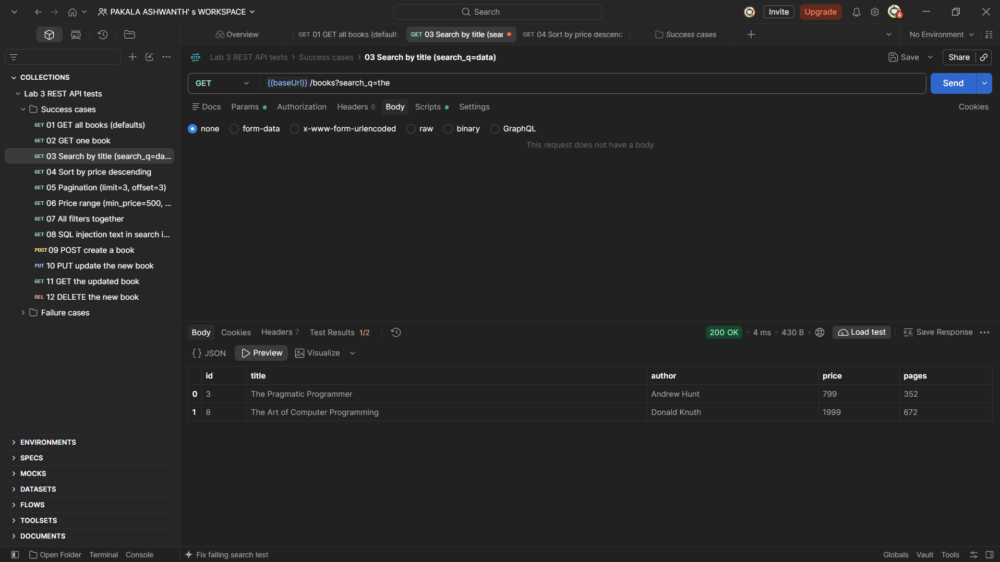

### Sort by price, descending

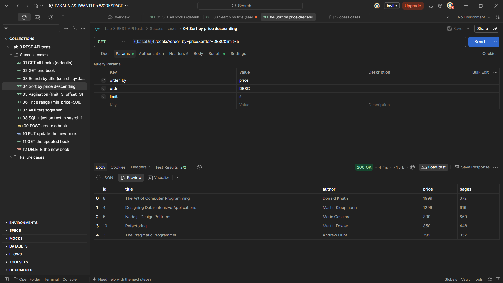

### Pagination

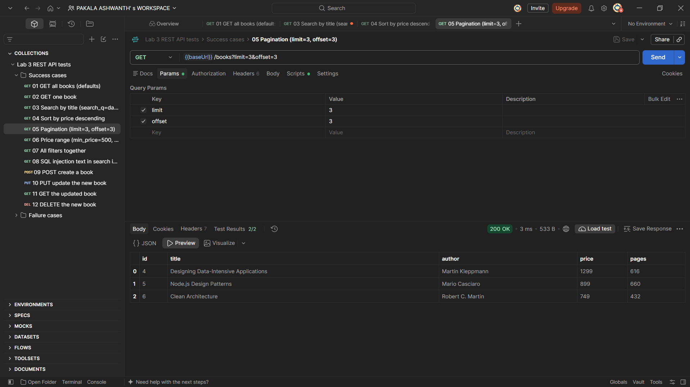

### Price range filter

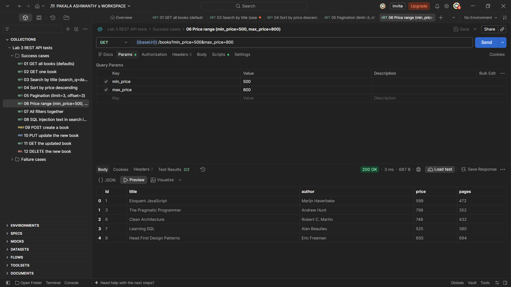

### POST creates a book (201)

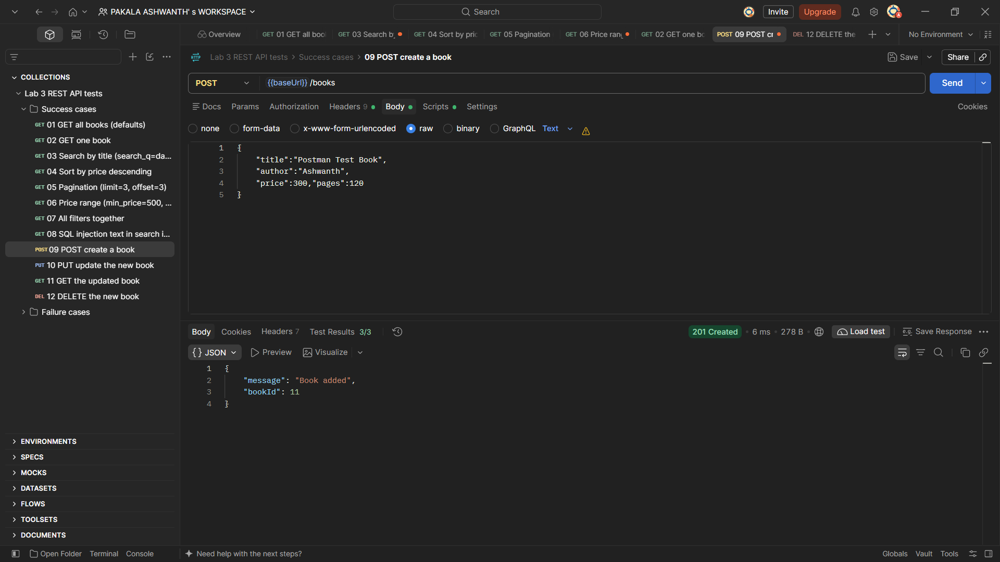

### PUT updates a book (200)

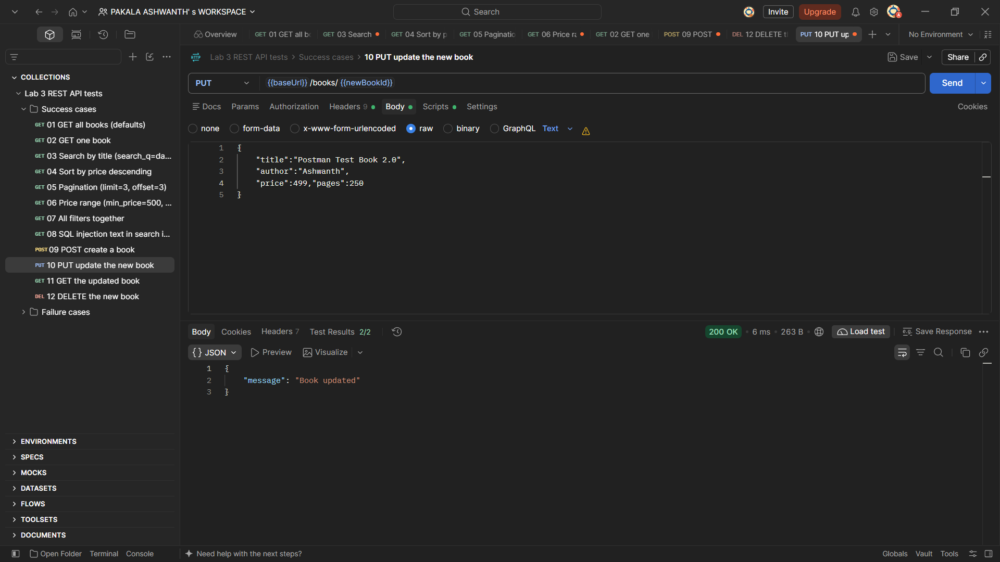

### DELETE removes a book (200)

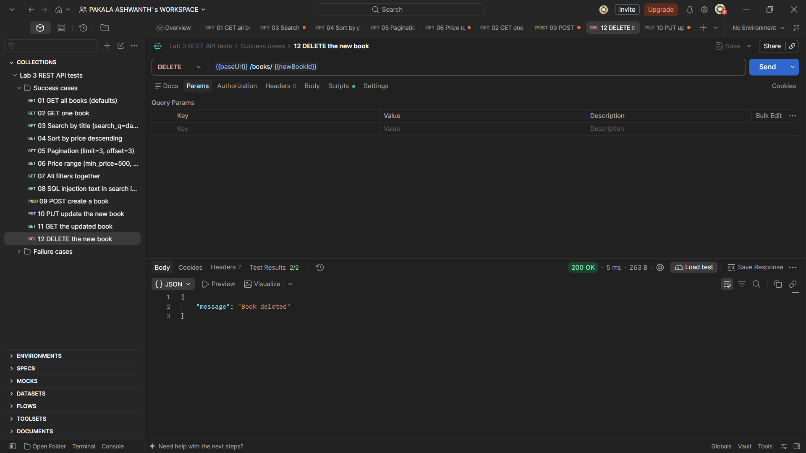

### Validation error: missing title (400)

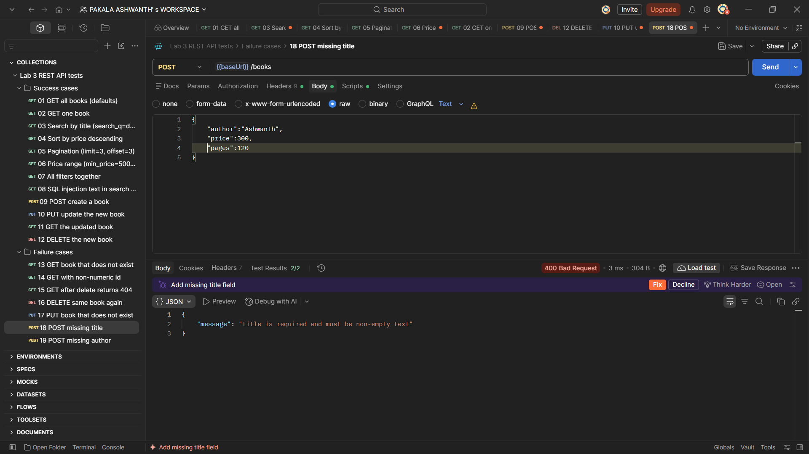

### Validation error: non-numeric price (400)

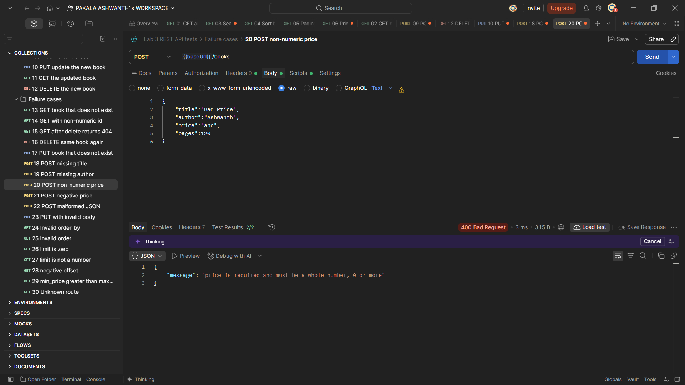

### Book not found (404)

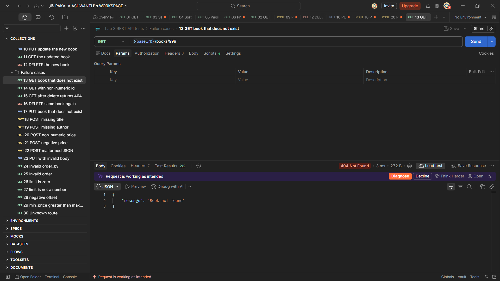

### All 30 Postman tests passing

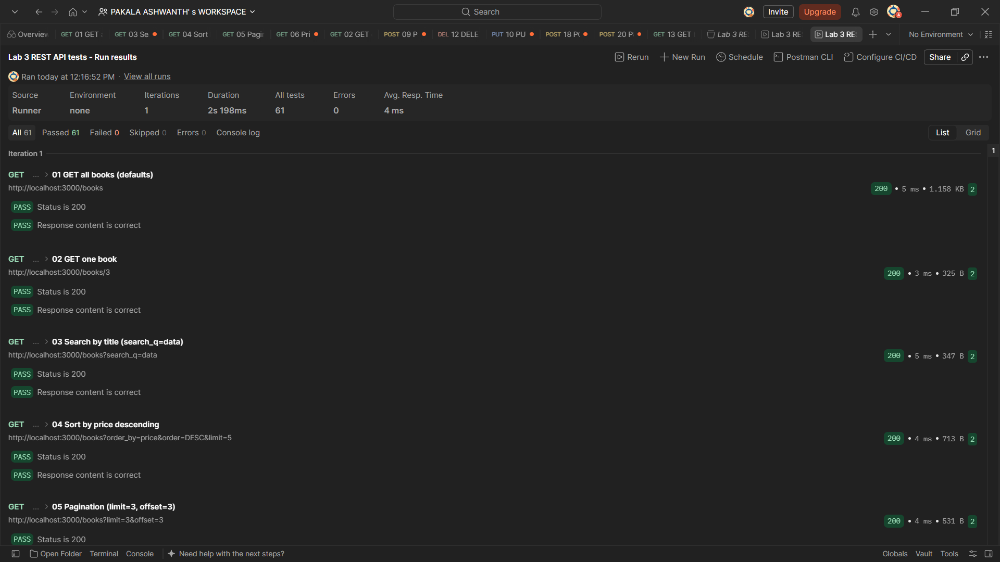

## Debugging Exercise

The faculty gave out a broken version of the project. The four errors I fixed:

| Error | Message I saw | Cause | Fix |
| --- | --- | --- | --- |
| Port conflict | `Error: listen EADDRINUSE: address already in use :::3000` | A previous Node.js process was still running in the background and holding port 3000. | Stopped the background process using `taskkill /IM node.exe /F` in PowerShell before restarting the server. |
| Wrong import path | `Error: Cannot find module './sqlite'` | The `require` statement used a relative file path (`./sqlite`) instead of the installed npm package name (`sqlite`). | Updated the import statement to `require("sqlite")` so Node resolves it from `node_modules`. |
| Table name typo | `SqliteError: no such table: boook` | The SQL query string in the route handler contained a typo in the table name (`boook` instead of `book`). | Corrected the query string to reference `book` everywhere. |
| Missing await | `TypeError: db.all is not a function` | The asynchronous `open()` database call was missing `await`, leaving `db` as an unresolved Promise when route handlers attempted to query it. | Added `await` before `open({ filename: DB_FILE, driver: sqlite3.Database })` during startup. |

## Notes

Problems faced and how I solved them:

- **PowerShell Script Execution Restriction:** When executing `npm start` on Windows, PowerShell threw a `PSSecurityException: UnauthorizedAccess`. Resolved this for the terminal session by running `Set-ExecutionPolicy -Scope Process -ExecutionPolicy Bypass`.
- **SQLite3 Version Compatibility for Deployment:** Native drivers often fail to compile in cloud environments. Pinned `sqlite3` to exact version `5.1.7` in `package.json` to ensure prebuilt binaries install seamlessly on Render without requiring build tools.
- **Malformed JSON Handling:** Malformed request bodies crashed the parser with a default HTML 400 response. Added centralized error handling middleware to catch parsing errors and return a clean, consistent JSON payload: `{ "message": "Request body contains malformed JSON" }`.
